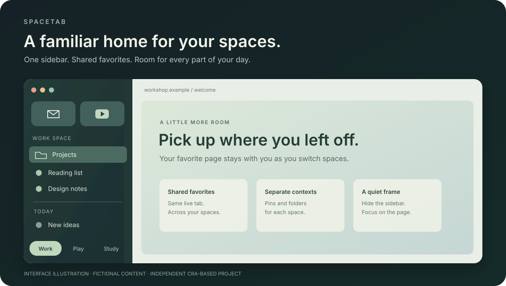

# SpaceTab

기존 **Arc Workshop**의 새 이름입니다. 같은 이름의 Chrome 확장과는 별개의 독립 macOS
브라우저입니다. 기존 탭·로그인·키체인과 업데이트 연결은 이어집니다. 예전 릴리스의 파일은
`Arc-Workshop.zip` / `Arc Workshop.app`, 새 다운로드는 `SpaceTab.zip` / `SpaceTab.app`입니다.
기존 앱을 업데이트하면 Finder의 폴더 이름은 예전 이름으로 남을 수 있지만 앱 안에는 SpaceTab으로 표시됩니다.

**스페이스를 오가던 익숙한 흐름을 이어가는 macOS 브라우저.**

[Mac용 다운로드](https://github.com/hyunchanwi/arc-workshop-updates/releases/latest) ·
[English](README.md) · [사용 안내](docs/guide.md) ·
[릴리스 기록](https://github.com/hyunchanwi/arc-workshop-updates/releases) ·
[문제 제보](https://github.com/hyunchanwi/arc-workshop-updates/issues/new/choose)

*개인 브라우징 정보가 없는 인터페이스 설명용 그림입니다. 실제 화면 캡처가 아닙니다.*

SpaceTab은 Arc에서 쓰던 스페이스, 즐겨찾기, 고정 탭 중심의 사용 흐름을
이어가기 위해 만든 **Cra 기반의 실험적 개인 포크**입니다. Swift로 만든 네이티브 UI와
Chromium/CEF 엔진을 사용하며, 자체 저장 공간과 업데이트 경로를 가집니다.

**앱 소스는 비공개**이고, 이 저장소에는 설치 파일·설명서·유지보수 도구가 공개되어 있습니다.
Arc·Dia·The Browser Company와 관계없는 독립 프로젝트입니다. Arc 전체 기능을
완벽히 재현한 제품이라는 뜻은 아닙니다.

## 스페이스를 바꿔도, 보던 페이지는 그대로

**Work**에서 즐겨찾기의 영상을 보다가 **Play**로 옮겨 같은 즐겨찾기를 누르면,
보던 실제 페이지로 돌아옵니다. Work에 고정한 탭은 Work에 남고, 공통으로 쓰는
즐겨찾기는 함께 따라옵니다. SpaceTab에서 가장 중요하게 다루는 흐름입니다.

처음 1분은 이렇게 시작하세요.

1. **맥락마다 공간 만들기.** Work·Play·Study 스페이스를 만들고 `⌃1`–`⌃9`로 오갑니다.
2. **자주 쓰는 사이트 가까이 두기.** 어디서나 쓸 사이트는 즐겨찾기에, 그 공간에만 둘 사이트는 고정 탭에 둡니다.
3. **페이지에 집중하기.** `⌘S`로 사이드바를 숨겼다가 탭이 필요할 때 다시 펼칩니다.

## 주요 기능

| 기능 | 동작 |
| --- | --- |
| 스페이스 | 스페이스마다 고정 탭·폴더·일반 탭을 나눕니다. 사이드바나 `⌃1`–`⌃9`로 전환합니다. |
| 공유 즐겨찾기 | 같은 로그인 프로필의 스페이스는 상단 즐겨찾기의 **실제 탭 하나**를 공유합니다. 다른 스페이스에서도 보던 페이지를 이어갑니다. 기본으로 켜집니다. |
| 세로 사이드바 | 일반적인 상단 탭 줄 없이 탭을 관리합니다. `⌘S`로 숨기거나 표시하고 가장자리에서 다시 펼칠 수 있습니다. |
| 고정 탭·폴더 | 특정 스페이스에 속한 사이트는 그 스페이스에 정리합니다. |
| Tidy Tabs | Mac 안의 Apple Intelligence 모델로 일반 탭을 묶습니다. macOS 26 이상과 사용 가능한 모델이 필요합니다. |
| 분할 화면·Peek·작은 창 | Cra에서 제공하는 탐색 기능을 사용할 수 있습니다. |
| Arc 가져오기 | 앱의 가져오기 화면에서 기존 사이드바 구성을 옮깁니다. 가져올 항목을 확인한 뒤 진행합니다. |
| 앱 업데이트 | 서명된 업데이트 목록과 파일을 검증하고 설치를 안내합니다. |
| 복구용 사본 | 업데이트 전에 기존 앱과 프로필을 Mac 안에 보관합니다. 복구는 수동입니다. |

트랙패드 스페이스 제스처와 가장자리 펼치기는 설정·입력 장치에 영향을 받습니다.
자동 동작 검증은 있지만 모든 하드웨어 조합에서 실사용 검증한 것은 아닙니다.
현재 코드에는 로컬 Easel·Boost 도구가 있지만 Arc의 전체 사용 흐름을 여기서 실사용
검증한 것은 아닙니다. Arc의 클라우드 공유·갤러리·계정 서비스는 제공하지 않습니다.

## 설치

**Apple silicon Mac(M1 이상), macOS 14 이상**을 지원합니다.
현재 이 저장소에서는 Intel Mac·Windows·Linux 설치 파일을 배포하지 않습니다.
Tidy Tabs는 별도 시스템 조건을 충족해야 합니다.

1. [최신 릴리스](https://github.com/hyunchanwi/arc-workshop-updates/releases/latest)를 엽니다.
2. **Assets → SpaceTab.zip**을 받아 압축을 풉니다.
3. **SpaceTab.app**을 **응용 프로그램** 폴더로 옮기고 실행합니다.
4. 기존 브라우저 구성을 옮기려면 앱의 가져오기 안내를 사용합니다.

현재 개인용 빌드는 **Apple 공증을 받지 않았습니다**. 과거 버전은 임시 개발 서명을
사용했고, 배포 파이프라인에는 이제 같은 개인 인증서로 계속 서명하는 경로가 들어 있습니다.
각 버전의 실제 서명 상태는 릴리스 설명과 `signing-status.json`이 있으면 그 파일에서
확인하세요. 개인 인증서는 Apple의 Developer ID 인증서와 다릅니다.

처음 내려받은 앱의 실행을 macOS가 막을 수 있습니다.
[Apple의 개별 앱 실행 허용 안내](https://support.apple.com/guide/mac-help/open-a-mac-app-from-an-unknown-developer-mh40616/mac)를
확인하세요. 이 프로젝트를 위해 시스템 전체 보안 설정을 해제할 필요는 없습니다.

**Workshop Storage** 키체인 접근을 묻는 창은 쿠키·저장된 로그인 정보의 암호화 키에
접근하는 승인입니다. Mac 암호는 macOS 창에만 입력하세요. 임시 서명에서 지속 서명으로
바뀔 때 한 번 더 승인할 수 있습니다. 키체인이 잠기거나 인증서·접근 정책이 바뀌면
나중에 다시 물을 수 있으므로 암호 창이 절대 뜨지 않는다는 보장은 아닙니다.

## 이렇게 사용하세요

- Work·Play·Study처럼 자주 오가는 맥락마다 스페이스를 만듭니다.
- 어디서나 이어볼 사이트는 상단 **즐겨찾기**, 특정 공간에만 둘 사이트는 **고정 탭**에 둡니다.
- `⌘T` 명령창, `⌘L` 주소 수정, `⌘S` 사이드바, `⌃1`–`⌃9` 스페이스 전환을 사용합니다.
- 닫은 탭은 `⌘⇧T`로 복구합니다. 창 닫기와 앱 종료는 서로 다른 동작입니다.
- 앱 메뉴의 업데이트 확인 명령으로 새 버전을 직접 확인할 수 있습니다.

**스페이스와 로그인 프로필은 다릅니다.** 서로 다른 계정으로 로그인하려면 프로필을
나눠야 합니다. 공유 즐겨찾기도 같은 로그인 프로필 안에서만 이어집니다.
자세한 설명과 복구 절차는 [사용 안내](docs/guide.md)에 있습니다.

## 시작하기 전에 궁금한 점

앱 이름이 Cra인가요, SpaceTab인가요?

여기서 배포하는 앱 이름은 **SpaceTab**입니다. **Cra**는 기반이 된 원본 프로젝트이며,
앱과 라이선스 안내에 원작자를 표시합니다. 업데이트 경로도 SpaceTab 전용입니다.

Arc가 설치되어 있어야 사용할 수 있나요?

일반적인 브라우징에는 필요하지 않습니다. 자체 Chromium/CEF 엔진과 로컬 프로필로
작동합니다. Arc에서 가져오기를 하려면 가져올 로컬 데이터가 있어야 합니다.
Arc의 클라우드 서비스가 함께 제공되는 것은 아닙니다.

업데이트할 때마다 Mac 암호를 입력하나요?

매번 입력하는 것이 의도된 업데이트 절차는 아닙니다. 같은 인증서로 서명해 앱 신원을
유지합니다. 기존 임시 서명에서 바뀌는 첫 업데이트, 잠긴 키체인, 인증서 변경 등의
상황에서는 승인을 다시 요청할 수 있습니다. 개인 인증서 서명은 Apple 공증과 다릅니다.

## 업데이트는 어떻게 만들어지나요?

유지보수 작업은 약 6시간마다 원본 Cra와 엔진 변경을 확인합니다. 변경이 있으면 통합,
테스트, 빌드, 실행·종료·복원 검증을 거쳐 앱 자체에 서명합니다. 그다음 업데이트 ZIP과
목록에도 별도의 서명을 붙여 GitHub Release로 배포합니다.

1.0.21부터 연결된 앱은 새 릴리스 신호를 받아 일반 서명 업데이트 확인을 요청합니다.
오프라인이었다면 재연결할 때 최신 신호를 받습니다. 약 8시간 주기 확인과 수동 확인도
예비 경로로 유지하며, 기본 설정에서는 사용자가 설치를 선택합니다. 업데이트 전에 기존
앱과 프로필을 로컬에 복사합니다. 알림·배포 완료 시간은 보장하지 않으며,
충돌·테스트 실패·서명 실패 때는 배포를 멈춥니다.

엔진은 호환되는 Cra의 패치된 CEF 바이너리가 있어야 갱신됩니다. 최신 Chromium이
나왔다고 즉시 포함되는 것은 아닙니다. GitHub의 공개 저장소 일정 실행은 60일간 활동이
없으면 중지될 수 있으며, 소유자가 다시 활성화해야 합니다.

[업데이트 구조](docs/updates.md) · [인증서 관리 안내](docs/signing.md)

## 데이터와 공개 범위

1.0.21부터 설정 → Privacy에서 개인 Google Safe Browsing API 키를 저장할 수 있습니다.
키는 이 Mac의 키체인에 저장하며 설치 파일에는 넣지 않습니다. 설정·재시작·위협 목록
다운로드가 필요하고, 키 저장만으로 보호가 확인되지는 않습니다. 현재 엔진의 성공한 목록
갱신 간격은 최소 24시간이며 광고 차단과는 별개입니다.
[설정과 확인 방법](docs/guide.md#dangerous-site-protection)을 참고하세요.
엔진 보안 업데이트도 호환 바이너리 공급에 영향을 받습니다.
현재 보안 범위와 검사 항목은 [SECURITY.md](SECURITY.md)에 정리합니다.

브라우징 데이터는 `~/Library/Application Support/Arc Workshop`, 업데이트 전 복사본은
`~/Library/Application Support/Arc Workshop Backups`에 보관합니다. 복사본에는 전체
브라우징 프로필이 들어갈 수 있으므로 개인 데이터로 취급하세요. 자동으로 업로드하지 않습니다.

탭 제목·URL을 포함한 모든 로컬 상태가 암호화되는 것은 아닙니다. 쿠키·저장된 비밀번호는
macOS 키체인의 **Workshop Storage** 키를 사용합니다. 설치 파일은 깨끗한 빌드 환경에서
코드로 만들며, 개발자의 사용 중인 탭·로그인 정보·백업은 포함하지 않습니다.
앱은 방문한 사이트 및 사용 기능에 필요한 서비스, 업데이트 확인용 GitHub와 통신합니다.
릴리스 신호는 전용 Cloudflare 서버에서 받으며 탭·프로필·장치 ID는 보내지 않습니다.
Safe Browsing을 설정하면 Google 보호 서비스와도 통신합니다.
Tidy의 탭 묶기는 Mac 안의 모델을 사용합니다.

## 피드백과 기반 프로젝트

[문제 제보](https://github.com/hyunchanwi/arc-workshop-updates/issues/new/choose)에는
앱·macOS 버전과 재현 방법을 적고 개인 URL·계정 정보를 지워 주세요.
민감한 보안 문제는 [SECURITY.md](SECURITY.md)를 참고하세요.

[Victor Kildahl의 Cra](https://github.com/VictorKildahl/cra), Chromium/CEF,
Sparkle을 기반으로 합니다. 앱 안에 원본 라이선스와 고지가 포함되어 있습니다.
공개 유지보수 도구는 [MIT 라이선스](LICENSE)이며, 앱 소스는 이 저장소에 포함되지 않습니다.
[서드파티 고지](THIRD_PARTY_NOTICES.md)도 확인할 수 있습니다.
