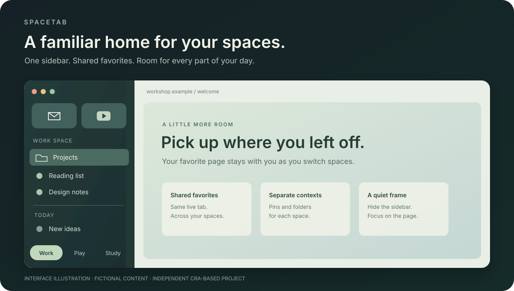
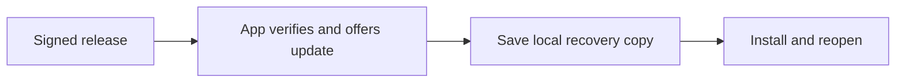

<h1 align="center">SpaceTab</h1>

  A familiar home for your spaces. 
  An independent, Cra-based macOS browser with a vertical sidebar and shared favorites.

  <a href="https://github.com/hyunchanwi/SpaceTab/releases/latest"><strong>Download for Mac</strong></a> ·
  <a href="README.ko.md">한국어</a> ·
  <a href="docs/guide.md">User guide</a> ·
  <a href="https://github.com/hyunchanwi/SpaceTab/releases">Release notes</a> ·
  <a href="https://github.com/hyunchanwi/SpaceTab/issues/new/choose">Feedback</a>

  
  
  
  

Interface illustration with fictional content; not a screenshot of a browsing profile.

SpaceTab started with a simple goal: keep the way an Arc user moves between spaces,
favorite sites and everyday tabs. It builds on [Cra](https://github.com/VictorKildahl/cra),
using a native Swift interface and Chromium through CEF. It has its own application identity,
storage folder and signed update feed.

**This is an experimental personal fork.** The browser source is private. This repository
contains public downloads, documentation and maintenance tooling. SpaceTab is an
independent project and is not affiliated with Arc, Dia or The Browser Company.

## Keep the page. Change the space.

Open a favorite video in **Work**, switch to **Play**, and choose the same favorite.
You return to the same live page. Your pinned Work tabs stay in Work; your shared favorites
come along. That distinction is the heart of SpaceTab.

Try it in a minute:

1. **Make room for each context.** Create Work, Play and Study spaces; switch with `⌃1`–`⌃9`.
2. **Keep a few sites close.** Add a favorite for the sites you use everywhere; pin the rest to their own space.
3. **Let the page take over.** Press `⌘S` to hide the sidebar. Bring it back when you need your tabs.

## What it does

| Feature | How it works |
| --- | --- |
| Spaces | Separate pinned tabs, folders and everyday tabs. Switch from the sidebar or use `⌃1`–`⌃9`. |
| Shared favorites | Spaces in the same login profile use the same live favorite tab. A page stays where you left it. Enabled by default. |
| App icons | Ice Blue is the default. Choose Mint Orbit, Graphite, Portal or your own image in Settings → General → App Icon. |
| Quiet sidebar | Vertical tabs without a conventional top tab strip. `⌘S` shows or hides the sidebar; edge reveal is supported. |
| Pinned tabs and folders | Keep regular sites organized independently in each space. |
| Tidy Tabs | Group everyday tabs using the Mac's on-device Apple Intelligence model. Requires macOS 26+ and an available model. |
| Split view, Peek and Little Windows | Cra's native browsing tools remain available. |
| Arc import | Bring over sidebar organization through the in-app import flow. Review selected data before importing. |
| Updates | Sparkle verifies signed feeds and archives. The app checks periodically and offers installation. |
| Recovery snapshots | The previous app and profile are copied locally before an update. Restore is manual. |

Trackpad space gestures and edge reveal depend on settings and input hardware. Automated
behavior checks exist; every hardware combination has not been tested. This is not a claim
of complete Arc feature parity. Local Easel and Boost tools are present in the current code,
but their full Arc workflows have not been verified here. Arc's cloud sharing, gallery and
account services are not provided.

## Install

**Requirements:** Apple silicon Mac (M1 or later), macOS 14 or later. This repository does
not currently publish Intel, Windows or Linux builds. Tidy Tabs has additional requirements.

1. Open the [latest release](https://github.com/hyunchanwi/SpaceTab/releases/latest).
2. Download **SpaceTab.zip** from **Assets** and unzip it.
3. Move **SpaceTab.app** to **Applications**, then open it.
4. Use the import prompt to bring over your existing browser organization if desired.

Current personal builds are **not Apple notarized**. Older releases use ad-hoc signing;
the maintenance pipeline now supports a persistent personal certificate. Check the release
notes and `signing-status.json` when present to see how a particular release was signed.
A personal certificate does not establish Apple Developer ID trust. macOS may block an
initial download; Apple's [instructions for opening an app from an unidentified developer](https://support.apple.com/guide/mac-help/open-a-mac-app-from-an-unknown-developer-mh40616/mac)
explain the per-app decision. No system-wide security changes are needed by this project.

If macOS asks SpaceTab to access **Workshop Storage**, that is its local Keychain
encryption key. Enter your Mac password only in the macOS dialog. Moving from an ad-hoc
build to the persistent identity may require approval once. A locked Keychain, certificate
change or access-policy change can still cause a later prompt.

Upgrading an older installation

Previously named **Arc Workshop**. SpaceTab is this independent macOS browser, not a Chrome
extension of the same name. The existing update channel and signing identity are retained.
Older releases use `Arc-Workshop.zip` and `Arc Workshop.app`; new downloads use `SpaceTab.zip`
and `SpaceTab.app`. An existing installation updated in place may retain its old Finder folder
name while showing SpaceTab in the app. Your profile and Keychain storage stay in their
existing locations.

The public repository is now `hyunchanwi/SpaceTab`. Existing signed update addresses
keep their original paths for compatibility and redirect to this repository.

## Useful keys

| Shortcut | Action |
| --- | --- |
| `⌘T` / `⌘L` | Open the command bar / edit the address |
| `⌘S` | Show or hide the sidebar |
| `⌃1`–`⌃9` | Switch spaces |
| `⌘D` | Pin or unpin a tab |
| `⌘⇧T` | Restore a closed tab |

The [user guide](docs/guide.md) covers login profiles, Tidy Tabs and recovery.

## How updates work

Maintenance checks roughly every six hours. New releases also send an event to connected
copies, requesting a normal signed-feed check. Offline copies catch up on reconnection;
eight-hour and manual checks remain as fallbacks. Delivery has no deadline guarantee.
Only changed source, engine or signing policy triggers a new build. Installation requires
your action by default.

Updates stop if integration conflicts, tests fail, the app identity changes unexpectedly,
or signing credentials are missing. Engine updates use compatible, checksummed binaries
from Cra; a newer Chromium release without a compatible patched CEF binary needs maintainer
work. Failed maintenance appears in Actions and a maintenance issue. Public GitHub schedules
can be disabled after 60 days without repository activity and need manual re-enabling.

Application code signing and Sparkle's update signatures are separate checks. Builds run
without application/update signing credentials; a separate publishing job signs artifacts
without executing the browser. See [update architecture](docs/updates.md) and the
[maintainer signing guide](docs/signing.md).

## Questions before you try it

From 1.0.21, Google Safe Browsing can be configured with your own API key in Settings →
Privacy. No shared key is included: protection needs setup and a successful threat-list
download. This engine's list refresh interval is at least 24 hours, and compatible patched
engine availability can delay Chromium security updates. Ad blocking is separate. See
[setup and limits](docs/guide.md#dangerous-site-protection) and [security scope](SECURITY.md).

Is the app called Cra or SpaceTab?

The app distributed here is **SpaceTab**. **Cra** is its upstream foundation and receives
credit in the app and license notices. This is an independent fork with its own update channel.

Do spaces give me separate logins?

Use separate **profiles** for separate accounts. Spaces organize tabs. Spaces using the same
profile share site login storage and, when enabled, favorites.

Does normal browsing depend on Arc being installed?

No. SpaceTab has its own Chromium/CEF engine and local browsing profile. Importing Arc
data needs the data to be available locally; normal browsing uses SpaceTab's own engine.
Arc's cloud services are not part of this app.

Will an update ask for my Mac password every time?

That is not an intended update step. A persistent certificate keeps the app's signing
identity stable. The first transition from an ad-hoc build can need Keychain approval,
and a locked Keychain or changed certificate can still prompt. Personal signing does not
provide Apple notarization.

Can I use SpaceTab on another Mac or a Mac mini?

Yes, on an Apple silicon Mac (M1 or later) running macOS 14 or later. Download the
same SpaceTab.zip; the published build does not support Intel Macs. Installation
starts with that Mac’s own browsing data. Settings → General → Sync → Export / Import
can transfer spaces, favorites, pinned tabs, settings and shortcuts. A shared-folder
provider can keep these in sync. Direct iCloud app sync is unavailable in this personal
build. Logins, cookies, history, extensions, app-icon preferences and the personal
Safe Browsing key stay on each Mac.

## Your data

Browsing data lives in `~/Library/Application Support/Arc Workshop`.
Update snapshots live in `~/Library/Application Support/Arc Workshop Backups` and can
contain your full browsing profile. They stay on your Mac and are not uploaded as releases.
Tab titles and URLs in local state are not all encrypted; cookies and saved passwords use
a key from **Workshop Storage** in the macOS Keychain.

Release archives are built from code on clean runners, not from the maintainer's live
browsing profile. This repository does not include tabs, cookies, passwords or browsing
backups. The app contacts sites you visit and services used by enabled features,
including GitHub for update checks. Local Tidy grouping uses Apple's on-device model.

## Feedback and credits

Report reproducible problems through [Issues](https://github.com/hyunchanwi/SpaceTab/issues/new/choose).
Include the app version, macOS version and steps, with personal URLs and account details
removed. See [SECURITY.md](SECURITY.md) for sensitive reports.

SpaceTab builds on [Victor Kildahl's Cra](https://github.com/VictorKildahl/cra),
[Chromium / CEF](https://bitbucket.org/chromiumembedded/cef), and
[Sparkle](https://sparkle-project.org). Upstream licenses and notices are included in the
app. Public maintenance tooling is MIT licensed; see [LICENSE](LICENSE) and
[third-party notices](THIRD_PARTY_NOTICES.md). The private browser source is not included here.
