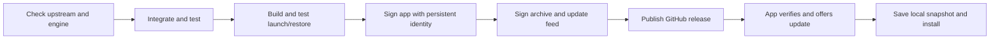

<h1 align="center">Arc Workshop</h1>

  A familiar home for your spaces. 
  An independent, Cra-based macOS browser with a vertical sidebar and shared favorites.

  <a href="https://github.com/hyunchanwi/arc-workshop-updates/releases/latest"><strong>Download for Mac</strong></a> ·
  <a href="README.ko.md">한국어</a> ·
  <a href="docs/guide.md">User guide</a> ·
  <a href="https://github.com/hyunchanwi/arc-workshop-updates/releases">Release notes</a> ·
  <a href="https://github.com/hyunchanwi/arc-workshop-updates/issues/new/choose">Feedback</a>

  
  
  
  

Interface illustration with fictional content; not a screenshot of a browsing profile.

Arc Workshop started with a simple goal: keep the way an Arc user moves between spaces,
favorite sites and everyday tabs. It builds on [Cra](https://github.com/VictorKildahl/cra),
using a native Swift interface and Chromium through CEF. It has its own application identity,
storage folder and signed update feed.

**This is an experimental personal fork.** The browser source is private. This repository
contains public downloads, documentation and maintenance tooling. Arc Workshop is an
independent project and is not affiliated with Arc, Dia or The Browser Company.

## What it does

| Feature | How it works |
| --- | --- |
| Spaces | Separate pinned tabs, folders and everyday tabs. Switch from the sidebar or use `⌃1`–`⌃9`. |
| Shared favorites | Spaces in the same login profile use the same live favorite tab. A page stays where you left it. Enabled by default. |
| Quiet sidebar | Vertical tabs without a conventional top tab strip. `⌘S` shows or hides the sidebar; edge reveal is supported. |
| Pinned tabs and folders | Keep regular sites organized independently in each space. |
| Tidy Tabs | Group everyday tabs using the Mac's on-device Apple Intelligence model. Requires macOS 26+ and an available model. |
| Split view, Peek and Little Windows | Cra's native browsing tools remain available. |
| Arc import | Bring over sidebar organization through the in-app import flow. Review selected data before importing. |
| Updates | Sparkle verifies signed feeds and archives. The app checks periodically and offers installation. |
| Recovery snapshots | The previous app and profile are copied locally before an update. Restore is manual. |

Trackpad space gestures and edge reveal depend on settings and input hardware. Automated
behavior checks exist; every hardware combination has not been tested. This is not a claim
of complete Arc feature parity. Easels, Boosts and Arc's cloud services are not provided.

## Install

**Requirements:** Apple silicon Mac (M1 or later), macOS 14 or later. This repository does
not currently publish Intel, Windows or Linux builds. Tidy Tabs has additional requirements.

1. Open the [latest release](https://github.com/hyunchanwi/arc-workshop-updates/releases/latest).
2. Download **Arc-Workshop.zip** from **Assets** and unzip it.
3. Move **Arc Workshop.app** to **Applications**, then open it.
4. Use the import prompt to bring over your existing browser organization if desired.

Current personal builds are **not Apple notarized**. Older releases use ad-hoc signing;
the maintenance pipeline now supports a persistent personal certificate. Check the release
notes and `signing-status.json` when present to see how a particular release was signed.
A personal certificate does not establish Apple Developer ID trust. macOS may block an
initial download; Apple's [instructions for opening an app from an unidentified developer](https://support.apple.com/guide/mac-help/open-a-mac-app-from-an-unknown-developer-mh40616/mac)
explain the per-app decision. No system-wide security changes are needed by this project.

If macOS asks Arc Workshop to access **Workshop Storage**, that is its local Keychain
encryption key. Enter your Mac password only in the macOS dialog. Moving from an ad-hoc
build to the persistent identity may require approval once. A locked Keychain, certificate
change or access-policy change can still cause a later prompt.

## A quick start

- Create a space for each context, such as Work, Play and Study.
- Put sites you want everywhere in **Favorites**. Pin sites that belong to one space below it.
- Use `⌘T` for the command bar, `⌘L` for the address, `⌘S` for the sidebar and `⌃1`–`⌃9` for spaces.
- Use `⌘⇧T` to restore a closed tab. Closing a window and quitting the app are different actions.
- Use the application menu's update command to check manually.

The [user guide](docs/guide.md) explains favorites, login profiles, Tidy Tabs and recovery.

## How updates work

Maintenance checks roughly every six hours; installed copies check about every eight hours.
These are scheduled checks, not a promise of delivery by a deadline. Only changed source,
engine or signing policy triggers a new build. Installation requires your action by default.

Updates stop if integration conflicts, tests fail, the app identity changes unexpectedly,
or signing credentials are missing. Engine updates use compatible, checksummed binaries
from Cra; a newer Chromium release without a compatible patched CEF binary needs maintainer
work. Failed maintenance appears in Actions and a maintenance issue. Public GitHub schedules
can be disabled after 60 days without repository activity and need manual re-enabling.

Application code signing and Sparkle's update signatures are separate checks. Builds run
without application/update signing credentials; a separate publishing job signs artifacts
without executing the browser. See [update architecture](docs/updates.md) and the
[maintainer signing guide](docs/signing.md).

## Your data

Browsing data lives in `~/Library/Application Support/Arc Workshop`.
Update snapshots live in `~/Library/Application Support/Arc Workshop Backups` and can
contain your full browsing profile. They stay on your Mac and are not uploaded as releases.
Tab titles and URLs in local state are not all encrypted; cookies and saved passwords use
a key from **Workshop Storage** in the macOS Keychain.

Release archives are built from code on clean runners, not from the maintainer's live
browsing profile. This repository does not include tabs, cookies, passwords or browsing
backups. The app contacts sites you visit and services used by enabled features,
including GitHub for update checks. Local Tidy grouping uses Apple's on-device model.

## Feedback and credits

Report reproducible problems through [Issues](https://github.com/hyunchanwi/arc-workshop-updates/issues/new/choose).
Include the app version, macOS version and steps, with personal URLs and account details
removed. See [SECURITY.md](SECURITY.md) for sensitive reports.

Arc Workshop builds on [Victor Kildahl's Cra](https://github.com/VictorKildahl/cra),
[Chromium / CEF](https://bitbucket.org/chromiumembedded/cef), and
[Sparkle](https://sparkle-project.org). Upstream licenses and notices are included in the
app. Public maintenance tooling is MIT licensed; see [LICENSE](LICENSE) and
[third-party notices](THIRD_PARTY_NOTICES.md). The private browser source is not included here.
